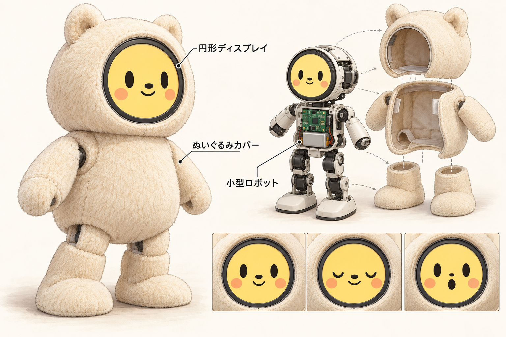

# GarMyFriend

丸い顔で表情を伝える、小さなぬいぐるみロボットを作るプロジェクトです。円形ディスプレイを顔に置き、小型ロボットの本体にぬいぐるみのカバーをかぶせます。将来は手足を動かし、脚で歩けるようにしていく構想です。



*目指す姿のコンセプト画像です。手足や歩行機構はこれから設計します。*

## まずは顔から

現在は、その顔の部分から作っています。Orange Pi Zero 2W（H618・ARM64・RAM 1GB）にGC9A01互換の円形ディスプレイとKY-040ロータリーエンコーダーをつなぎ、実機で動作確認済みです。目・鼻・口・頬を幾何図形で描き、ノブの回転で8つの表情を切り替えます。押すとまばたきします。

開発時は同じ顔アプリをVirtualBoxのLinux上で動かし、HTTPSのWebPanelを実物の部品の代わりに使います。WebPanelに置くのは、顔のディスプレイと表情を変えるノブの2点です。

手持ちノブの型番は **[KY-040](hardware/modules/KY-040.md)**。液晶は **[YMS PARTS 1.28インチ円形IPS・7ピン](hardware/modules/round-lcd-7pin.md)**（商品モデル番号 YMS-circlelcd-pinari）として記録しています。[実機の配線表](hardware/WIRING.md)はVMの仮想GPIO番号と区別して管理します。

部品・型番は [`hardware/components.csv`](hardware/components.csv)、物理配線は [`connections.csv`](hardware/connections.csv) が正本です。VMの実行時割り当ては `gpio.csv`・`spi.csv` から読みます。[CSVの役割](hardware/README.md)

```text
WebPanelのノブ → Bridge → gpio-sim → /dev/gpiochip0
                                            ↓
                              独立した顔アプリ（表情・アニメーション）
                                            ↓
WebPanelの液晶 ← Bridge ← GC9A01仮想ドライバ ← /dev/spidev0.0
```

**表情を決めるのは実行アプリです。** WebPanelとBridgeは、部品の入力信号とドライバが受け取った画素を受け渡します。顔アプリはWebPanelを停止しても動作します。

## 使う

このPCでは専用VM `gar-myfriend-sim` を構築済みです。

```powershell
npm run vm:start
npm run vm:open
```

URLは `.gar/vm/panel.json` に保存します。トンネルやVMの再起動後は `npm run vm:publish` で開発用HTTPS URLを発行し直してください。

```powershell
npm run vm:deploy   # 変更を転送して再ビルド
npm run vm:status   # アプリ・部品・パネルの状態
npm run vm:stop     # 専用VMを終了
```

Cloudflare Quick TunnelのURLは再発行すると変わります。開発用の模擬部品を公開しています。

実機では専用の `garmyfriend` サービスで同じ顔アプリを自動起動します。実機用GPIO/SPIは `hardware/orangepi-zero2w/` から読み、WebPanelを必要としません。[実機の導入・確認手順](infra/orangepi-zero2w/README.md)

## ソースの役割

| 場所 | 役割 |
| --- | --- |
| `application/` | 表情の選択、アニメーション、GPIO入力、SPIへの描画出力。HTTPやWebPanelに依存しない |
| `simulation/` | 仮想GPIOへの入力と、ドライバが受け取った画素の中継。表情の意味を持たない |
| `simulator/` | 共有の液晶・ロータリー部品だけを配置するWebPanel |
| `hardware/` | 部品・物理配線と、VM / Orange PiそれぞれのGPIO・SPI割り当て |
| `sources/gar-tools/` | 共有Web Components、GPIO入力、CUSEドライバ、汎用Bridgeのsubmodule |
| `shared/expressions.json`、`firmware/` | 表情データとC++描画コア |
| `infra/virtualbox/`、`tools/vm.py` | 専用VMとサービスの構築・配布 |
| `infra/orangepi-zero2w/` | 実機のARM64ビルド、SPI有効化、専用ユーザーでの自動起動 |

クローンは `git clone --recurse-submodules https://github.com/ThousandsOfTies/GarMyFriend.git`。実行アプリはNode.js 18以上とLinuxのGPIO v2・SPIを利用します。実機ではNode.js 24.22.1 ARM64を使用し、GPIO/SPIの割り当て、ノブ入力、液晶の顔表示を確認済みです。

## 検証

```powershell
npm ci
npm test
npm run test:vm
```

ローカル試験では表情処理、Bridgeが表情を判断しないこと、2部品の画面と入出力を確認します。VM試験は実際の仮想GPIO・SPIと画面の画素一致を確認します。VM内の `python3 -B tests/vm-parts.py` は、顔アプリを止めたときにBridgeだけでは表情を変えられず、WebPanelを止めてもアプリが動くことを確認します。

[操作・再構築手順](SIMULATOR.md) / [設計](DESIGN.md)
